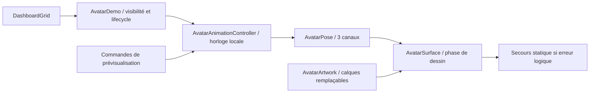

# AVATAR-001 — fondation du prototype 2.5D

## Référence et périmètre

Branche : **feature/interface-avatar-001**. Base : **test/interface-device-006**,
`ebd6c5fc873054d3f04bb2388d53e407dc73b7b7`. Le commit de livraison et le run exact
figurent dans le bilan final et l’historique de cette branche. Aucun merge, changement
de `main`, de branche par défaut ou d’un autre dépôt. La validation physique de
mission 006 reste en attente et n’est pas présentée comme achevée.

Les fichiers AvatarContract, DashboardGrid, JarvisApp, Dashboard, les règles et les
tests ont été examinés. Le contenu Avatar était un texte dans une colonne défilante,
entre titre/verrou et poignées. Cette enveloppe et ses tags restent compatibles.
Seul le contenu du panneau est remplacé ; les gestes de placement et les profils
ne sont pas réécrits. Aucun nouvel état dans HomeState ou le JSON V1.

## Choix du moteur

| Option | Intérêt / coût | Décision |
| --- | --- | --- |
| Compose Canvas et calques | Déjà disponible ; chemins, masques et transformations locales ; contrôle du cycle de vie sans autre runtime. Déformation de visage limitée sans rig/mesh. | Retenu pour démontrer les trois mouvements et le remplacement des ressources. |
| Moteur 2D articulé spécialisé | Rig, courbes et outil d’édition plus avancés ; pipeline artistique et runtime supplémentaires (ex. Rive/Spine). | Réévaluer après validation des assets ; versions, licences et budgets à vérifier. |
| SDK externe Android type Cubism | Déformations 2.5D riches ; intégration native/ABI, outil, distribution et licence à valider. | Aucun SDK lourd ajouté ni décision implicite sur le moteur définitif. |

Le prototype n’utilise ni bitmap aplati animé en bloc, ni vidéo présentée comme rig,
ni moteur 3D. Plusieurs plans vectoriels se transforment indépendamment : cheveux
arrière à 45 % de la rotation de tête, visage/yeux/frange autour du cou, mèches/nez
avec parallaxe différente, buste respirant séparément. Gradients, masques de paupières
et ordre de recouvrement donnent la profondeur simulée. Ce n’est pas un modèle
artistique cinématique définitif ; aucun fichier de référence n’a encore été fourni.

## Responsabilités et intégration



- `AvatarContract.kt` : contrat existant visibilité/dimensions/libération conservé ;
  MediaKind MP4/2D/hybride reste une frontière future, sans lecteur ajouté.
- `AvatarAnimationController.kt` : Kotlin sans Android/Compose/timer/fichier ;
  commandes explicites, courbes, compatibilité, pause et statut terminal de libération.
- `AvatarArtwork.kt` : interface de rendu normalisé 240×320 et de libération ;
  démo procédurale originale, formes statiques réutilisées et paupières indépendantes.
- `AvatarDemo.kt` : hôte Compose, un seul contrôleur/clock, surface adaptée à la
  taille, détection de clipping et preview défilante. La pose est lue au dessin,
  sans recomposer le dashboard à chaque frame. L’image du panneau est figée quand
  la preview devient la surface animée.
- `DashboardGrid.kt` : branche AVATAR appelle AvatarDemo dans son contenu existant,
  avec `avatar-placeholder` conservé pour les anciens tests. Aucun changement des
  contraintes, des poignées, verrous ou identifiants de panneaux.

`AvatarArtwork` pourra être remplacé par un renderer à textures/rig local respectant
ces repères ; il devra charger hors du fil UI et libérer ses ressources. Le prototype
actuel ne charge aucune texture, aucun fichier distant et aucun décodeur multimédia.
[Liste précise des assets et pivots](assets-definitifs.md).

## Contrats de commande et animations

| Identifiant stable | Animation | Courbe / combinaison |
| --- | --- | --- |
| ANIM_001 | IDLE | Cycle 4 200 ms, respiration (1−cos)/2 ; buste monte de 2 unités et s’élargit de 1,2 % au maximum, retour neutre à chaque cycle. |
| ANIM_002 | BLINK | Fermeture smoothstep 100 ms, maintien 30 ms, ouverture 130 ms ; déclenchement manuel ou attente aléatoire 2 800–6 200 ms après ouverture. |
| ANIM_003 | HEAD_TILT | ±5,5°, entrée 650 ms, maintien 200 ms, retour 1 350 ms ; signe alterné entre déclenchements. |

PLAY_ANIMATION, STOP_ANIMATION, SET_STATE, RESET_AVATAR sont explicites dans le
contrat Kotlin ; aucun protocole IPC n’est implémenté. Les trois canaux sont
compatibles entre eux. Rejouer un pulse encore actif ne le redémarre pas ; il n’y
a pas de seconde animation concurrente sur le même canal.

STOP conserve la pose instantanée puis la ramène au neutre en ~350 ms. STOP BLINK
arrête aussi l’automatisme ; un BLINK manuel n’active pas implicitement un nouveau
automatisme. RESET fond les trois canaux au neutre puis reprend IDLE et les clignements
variables ; STOP pendant RESET annule cette reprise. Un RESET d’avatar ne réinitialise
jamais les dispositions. Les états IDLE/LISTENING/THINKING/SPEAKING sont déclarés ;
les trois derniers changent le contrat d’état, sans son, IA ni animation spécifique.

## Horloge, visibilité et ressources

- Un hôte visible au premier plan est seul à avancer le contrôleur ; cadence de
  mise à jour **visée à environ 30/s**, asservie au frame clock, pas une
  mesure de FPS physique. Une image de rendu peut être présentée à une autre cadence.
- Les restes du budget de cadence sont conservés ; le temps effectivement écoulé
  entre calculs est intégré une fois. Les grands écarts sont bornés à 100 ms.
- La surface signale ses dimensions et ses limites **clippées** dans la fenêtre.
  Si sa partie visible est vide, le clock est suspendu ; le scroll de la grille ou
  du contenu du panneau peut masquer le dessin sans supprimer le composant.
- Le lifecycle RESUMED est requis. Un observer applique immédiatement le gate de
  premier plan ; une génération d’événements redémarre l’origine du clock après
  pause/reprise, même si les recompositions ont été coalescées. La collecte StateFlow
  suspendue en arrière-plan n’est pas utilisée comme unique signal de cancellation.
- Un STOP de tous les canaux finit son retour au neutre puis ne demande plus de
  frames. Pas de minuterie indépendante, polling réseau ou service permanent.
- Disposal annule l’effet de clock, retire l’observer, libère le contrôleur et le
  renderer. Contrôleur libéré : commandes refusées, plus aucun calcul.
- Rotation/recréation : un nouvel hôte redémarre au neutre/IDLE, sans dépendance à
  un service. Le renderer s’adapte en pixels et la disposition métier reste durable.
- Erreur logique de renderer : secours statique indépendant, échec mémorisé, horloge
  suspendue. RESET permet une tentative explicite, remplacement de renderer efface
  son ancien échec. Cela ne garantit pas une récupération après OOM ou perte du
  contexte graphique/processus, qui dépasse un fallback applicatif.

## Validation et preuves

Les résultats réellement exécutés sont ajoutés dans la section finale ci-dessous.
Le test d’image compare les pixels de chaque animation à une pose neutre et vérifie
le retour au même dessin après arrêt ; il ne suffit pas d’afficher « Animé ».
Les tests de pause comparent aussi le compteur réel de frames et la pose avant/après
un intervalle caché, arrêté ou en arrière-plan. Les tests précédents restent actifs.

Une première assertion JVM a détecté une inclinaison neutre représentée par −0,0
après un STOP ; la fin de fondu est désormais canonisée à 0,0, sans relâcher le test.
Deux assertions instrumentées ont ensuite été corrigées pour livrer une frame de
mise en page avant de mesurer un composant déplacé/supprimé avec le clock figé.
La mesure de pause exige désormais explicitement un dessin non affiché et un gate
inactif **avant** capture du compteur ; l’égalité du compteur n’est pas assouplie.

## APK et essais utilisateur

[Guide d’installation et commandes](guide-test.md). Le workflow de la branche
produit **jarvis-interface-avatar-kit** : APK de l’application, guide, architecture,
assets requis, provenance du commit et empreintes. Les trois artefacts précédents
restent disponibles. La CI compile les tests Android mais ne les exécute pas sur
son runner standard ; les résultats d’émulateur sont séparés.

Les signatures debug entre CI peuvent différer : ne pas désinstaller une version
existante pour contourner un conflit si ses dispositions doivent être conservées.
Le kit indique son propre SHA ; les empreintes locales ne vérifient pas un APK CI
signé ailleurs. Aucun APK n’est présenté comme installé sur POCO/Redmi sans test réel.

## Limites, risques et suite

- Références artistiques et assets multicouches définitifs absents ; la démo vectorielle
  originale est volontairement temporaire. Pas de mesh 3D, SDK de rig ni personnage final.
- Aucun lip-sync, visème, phonème, audio, état de parole animé, connecteur ou permission
  Internet. Domaines, DataStore V1, navigation et services existants préservés.
- Pas de mesures physiques CPU/GPU/RAM, thermique, démarrage ou FPS sur les deux
  appareils cibles ; aucune économie ou fluidité matérielle n’est inventée. Les temps
  de build/test ne sont pas présentés comme des performances applicatives.
- Risques : clipping/ergonomie avec texte maximal, surfaces partiellement visibles,
  coût futur des textures, raccords de calques, changements de lifecycle et signatures
  debug. Les pauses, pixels, reprises, redimensionnement et non-régression sont testés ;
  les surfaces partiellement visibles restent actives par choix.
- Prochaine mission recommandée après validation : recevoir/valider les deux références,
  préparer les calques et pivots, puis remplacer les ressources de démo avec mesure sur
  POCO/Redmi. Ne pas engager automatiquement voix, lip-sync ou SDK natif.

Aucune fusion et aucune mission suivante sans validation utilisateur.

## Résultats exécutés — code final

```sh
./scripts/check.sh connectedDebugAndroidTest --no-daemon
python3 scripts/package_device_kit.py
python3 scripts/package_device_kit.py --avatar
python3 scripts/verify_storage_restart.py --serial emulator-5554 --allow-layout-reset \
  --output app/build/reports/avatar-storage-restart
```

Résultat du check final : **BUILD SUCCESSFUL**, 3 min 27 s, 77 tâches (11 exécutées,
66 incrémentales). Les rapports JVM actuels correspondent au contrôleur final ;
les tâches déjà valides peuvent être UP-TO-DATE, sans être comptées comme une nouvelle
exécution. La CI reconstruit et exécute les tests JVM du commit poussé.

- **76 tests JVM réussis, 0 échec/erreur/ignoré** : 59 existants + 17 contrôleur.
  Courbes, combinaisons, retrigger, pause, reprise, taille zéro, release, temps
  invalides, arrêt/reset continus et intervalles variables sont couverts.
- **29 tests instrumentés réussis, 0 échec/erreur/ignoré** : les 20 précédents,
  7 tests moteur/rendu et 2 intégration dashboard. Le test de pause réelle utilise
  ActivityScenario CREATED → RESUMED ; un second couvre le signal LifecycleRegistry.
- Les pixels de **chaque** animation diffèrent du neutre puis reviennent au même
  dessin. Hors écran, un composant effectivement non affiché a un compteur stable
  sur 1 500 ms de clock contrôlé. Le même invariant est vérifié en arrière-plan,
  après disposal et après fallback. Le renderer injecté en erreur n’est pas rappelé
  continuellement et sa libération est vérifiée.
- `assembleDebug`, `assembleDebugAndroidTest` : réussis, APK présents.
- `lintDebug` : **No issues found.**
- Kit local : cinq empreintes vérifiées, un seul APK application et ses documents.
  Source non commitée marquée comme telle avant livraison ; le kit du commit propre
  porte son SHA exact. Les deux variantes de packaging ont été exécutées.

Environnement : émulateur Android 8.0/API 26 x86_64, 720×1280 / 320 dpi, rendu logiciel
sans KVM, mode avion. Fenêtres Compose et clock de test contrôlés pour les tests
moteur. Les tests antérieurs restent exécutés, sans suppression ni désactivation.
Aucun autre partenaire JARVIS n’est requis ou installé pour ces essais.

Preuves versionnées : [JUnit Android](validation/instrumented.xml),
[compilation, suites JVM, Lint, empreintes APK](validation/build.json).
Rapports complets locaux : `app/build/test-results/testDebugUnitTest/`,
`app/build/reports/lint-results-debug.*`, `app/build/outputs/androidTest-results/connected/debug/`,
`app/build/reports/androidTests/connected/debug/`.

### Restauration après arrêt réel du processus

Le script ADB existant a été exécuté sur l’application avec avatar : **10 scénarios
réussis, 0 échec**. Il couvre première installation, déplacement/redimensionnement/
verrouillage, profils indépendants, placement refusé, arrêt forcé depuis dashboard
et paramètres, réinitialisation durable, corruption, version inconnue et conservation
des autres données. Les PID observés changent de 3488 à 4148, puis 4515 et 4804,
avec absence de processus vérifiée avant chaque relancement. Il ne s’agit pas d’une
simple recréation d’activité. Aucun redémarrage complet de l’émulateur n’a été testé
pour cette mission. [Preuve JSON](validation/storage-restart.json).

### Captures du prototype

Captures réelles du même émulateur, réalisées le 17 octobre 2026 :
[dashboard compact](validation/dashboard.png), [prévisualisation](validation/preview.png),
[fenêtre large](validation/wide.png). La fenêtre large est simulée par `wm size
1600x1200` / densité 240 ; le framebuffer de cet AVD reste portrait et présente
des bandes noires. Il ne s’agit pas d’une tablette physique. La capture de prévisualisation a nécessité une
recherche par texte : les test tags Compose ne sont pas exportés comme resource-id
par cette fenêtre Dialog séparée. Cela ne concerne pas les tests Compose exécutés.
Les captures illustrent le rendu, sans prouver à elles seules le mouvement ou les
performances ; les tests de pixels et de compteur décrits plus haut couvrent ces
invariants. Le passage compact → large → compact et la prévisualisation n’ont pas
modifié les octets du fichier de dispositions sauvegardé.

### Fichiers créés / modifiés

Créés :

- `app/src/main/.../avatar/AvatarAnimationController.kt`
- `app/src/main/.../avatar/AvatarArtwork.kt`
- `app/src/main/.../avatar/AvatarDemo.kt`
- `app/src/test/.../avatar/AvatarAnimationControllerTest.kt`
- `app/src/androidTest/.../AvatarMotionTest.kt`
- `app/src/androidTest/.../AvatarDashboardTest.kt`
- `docs/avatar/architecture-et-validation.md`, `guide-test.md`, `assets-definitifs.md`
- `docs/avatar/validation/` : preuves et captures de l’émulateur.

Modifiés : `avatar/AvatarContract.kt` (commentaires du contrat existant),
`ui/DashboardGrid.kt` (contenu Avatar), `scripts/package_device_kit.py` (option
`--avatar`, mode historique conservé), `.github/workflows/android.yml` (kit supplémentaire),
`README.md` (utilisation actuelle).

Inchangés par rapport à ebd6c5f : `JarvisApp.kt`, modèle Dashboard/HomeState,
contrôleur de dispositions, DataStore/codec/schéma V1, manifeste, dépendances et
versions Gradle. Aucun nouveau module ni permission. Les images de référence et les
appareils physiques sont absents ; cela ne bloque pas ce prototype vectoriel autorisé,
mais bloque la validation artistique finale et toute performance physique.
