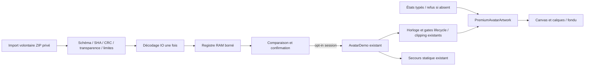

# AVA-03 — livraison et architecture

## Statut et périmètre

**PARTIAL — code d'intégration livré ; ART_ASSETS_MISSING ; DEVICE_NOT_QUALIFIED.**
CODE_READY : compilation, tests JVM et Android, Lint validés ci-dessous.
Ce n'est pas une livraison artistique premium achevée. L'activation durable du
rendu Athéna officiel reste subordonnée aux assets et à l'accord esthétique.

Branche : `feat/ava-03-athena-premium`. Base UI-01 :
`48db1ecbb40dfa5b90a8e696fe6c2a62228f5ce9`, qui contient AVA-01 :
`0c6d8a1bdeabe8f23fe8f98263cfe88d8c3c216e` (ascendance Git vérifiée).
La recherche des branches publiées a trouvé AVA-01, UI-01, la branche de planification
et les anciennes missions ; aucune branche de livraison AVA-02/UI-02 identifiée.
Les dossiers de planification ne sont pas considérés comme du code livré.
Aucun tag distant trouvé ; cette recherche ne prouve pas l’absence de travaux non publiés.

Aucun merge, changement de branche par défaut, modification de `main` ou autre
dépôt JARVIS. UI-03 n'est pas commencée. Le commit final et le run exact figurent
dans le bilan de livraison et dans `SOURCE.txt` du kit produit par la CI.

## Fichiers et responsabilités

| Fichier | Responsabilité |
| --- | --- |
| `avatar/v2/PremiumAvatarManifest.kt` | Schéma V2 strict, états/expressions/vues, pivots et correspondances. |
| `avatar/v2/PremiumAssetValidator.kt` | ZIP en mémoire borné sans extraction, hash, PNG/RGBA/CRC, budgets et refus. |
| `avatar/v2/AvatarPackRepository.kt` | Registre de session validé, budget cumulé, confirmation, précédent/rollback. |
| `avatar/v2/PremiumAvatarArtwork.kt` | Décodage hors rendu, adaptateur AvatarArtwork, calques, fondu et ressource libérable. |
| `avatar/v2/AvatarExpressionStateMachine.kt` | Événements typés, sélection exacte, refus d'asset absent, reset ; port VOICE facultatif sans implémentation. |
| `avatar/v2/AvatarV2Preview.kt` | Import SAF volontaire, comparaison, commandes, diagnostic et confirmation. |
| `avatar/AvatarDemo.kt` | Seul point d'intégration production existant modifié : entrée V2, rendu opt-in et extension du clock. |
| `assets/avatar-v2-demo/manifest.json` | Adaptation des cinq PNG publics existants, une seule correspondance réelle. |
| `assets/avatar-v2/availability.json` | Statut explicite d'absence d'Athéna premium ; pas un faux pack validable. |
| `test/.../avatar/v2/PremiumAvatarTest.kt` | Schéma, état, import hostile, intégrité, sélection et budgets. |
| `androidTest/.../avatar/v2/*Test.kt` | Décodage Android, pixels, lifecycle, preview, confirmation et intégration dashboard. |
| `androidTest/.../DashboardInteractionTest.kt` | Barrière d'attente du stockage ajoutée au test existant de verrouillage ; assertions conservées. |
| `README.md`, `.gitignore` | Usage actuel et garde contre l’ajout accidentel de la référence privée. |
| `scripts/check_avatar_v2_assets.py` | Vérification des vrais fichiers, du ZIP technique et du statut artistique honnête. |
| `scripts/check_ui01_scope.py` | Protection de 59 fichiers AVA-01/UI-01 existants, empreinte du fixture CORE de test seulement. |
| `scripts/package_device_kit.py` | Option supplémentaire `--avatar-v2`, modes précédents conservés. |
| `.github/workflows/android.yml` | Vérification V2 et artefact partiel supplémentaires ; chaîne SDK/build/tests/Lint conservée. |
| `docs/avatar/v2/` | Carte des assets, revue artistique, guide, ZIP synthétique et preuves réellement obtenues. |

Inchangés : contrôleur d'animation, contrats Avatar/V1, artwork vectoriel/fallback,
loader/manifeste/preview V1, PNG V1, DashboardGrid, JarvisApp/chat UI-01, modèles,
stockage DataStore/JSON V1, manifeste Android, dépendances et minimum API 26.

## Flux de rendu



La sélection V2 est nulle au démarrage. L'import ne choisit pas de renderer pour
le panneau. Après confirmation, le renderer utilise le même AvatarAnimationController
pour respiration, clignement et inclinaison. Le contrat facultatif
FrameDrivenAvatarArtwork réclame des frames pendant un fondu/mouvement de bouche,
même si IDLE a été arrêté ; il n'introduit aucune minuterie indépendante. Les
gates RESUMED, visibilité clippée, dimensions et fallback s'appliquent aux deux.
Le panneau parent est suspendu pendant sa preview V2, sans second clock actif caché.

Les images sont décodées à la validation/au chargement, jamais à chaque changement
d'état ni frame. Le fondu ~250 ms est piloté par l'horloge existante. Un nouvel
événement durant le fondu est refusé explicitement, sans réinitialisation brutale.
La bouche éventuelle se déplace vers une cible manuelle en ~150 ms : aucune
synchronisation phonétique. Les variantes réutilisent les textures bornées.

À la fermeture d'un hôte, le renderer lâche ses références et son horloge s'arrête ;
les textures partagées par un pack de session ne sont pas recyclées alors qu'un
Canvas les utilise. Le registre disparaît avec l'hôte. Après recréation/processus,
le renderer V1 est à nouveau sélectionné, les dispositions étant indépendantes.

## Sécurité et provenance

Aucun réseau, micro, moteur IA, accès stockage global ou service permanent. SAF
n'enregistre pas de permission persistante ; le ZIP reste en RAM. Les chemins sont
stricts, les noms/états/calques ambigus refusés, les ressources supplémentaires ou
manquantes refusées. Décompression bornée avant décodage, hashes et CRC avant
inspection bitmap, RGBA avec pixels transparents et visibles, limites du V1 conservées.
Les erreurs gardent le pack courant et sont affichées dans une région accessible.

Le registre refuse un remplacement sous le même ID ou un dépassement cumulé des
textures. Le champ auteur/licence est déclaratif, **pas** une preuve de droits ou
une signature cryptographique. L'utilisateur doit choisir et examiner ses imports.
Aucun fichier importé ni référence privée ne rejoint Git, CI, APK public ou captures.

## Validation

Les résultats finaux, captures et limites sont consignés après exécution. Le premier
passage instrumenté a été arrêté après 34/45 tests : deux assertions ont échoué
(verrouillage asynchrone et comparaison avec clock figé), puis le test de scroll
bloqué a été interrompu volontairement, signalé comme troisième échec/processus arrêté.
Les tests non terminés de ce passage ne sont pas comptés comme réussis.

Corrections : attente de la barrière de transaction existante avant les assertions
de verrouillage ; clock automatique pour la navigation/scroll de preview, horloge
manuelle conservée pour les vrais tests d'arrêt de calcul. Aucune assertion métier
supprimée ni règle de verrouillage modifiée. Deux tests supplémentaires couvrent
les canaux œil/bouche et l'entrée depuis le dashboard après ce premier passage.

Le passage suivant a terminé 47 tests : 46 réussis, un échec d'assertion de texte
(le test attendait une égalité avec `ART_ASSETS_MISSING` alors que le libellé complet
est `PARTIAL · ART_ASSETS_MISSING`). L'assertion vérifie désormais exactement ce
libellé complet. Deux recommandations Lint informatives sur le boxing des Float
ont été résolues avec `mutableFloatStateOf`, sans changement de comportement.

### Résultats finaux exécutés

```sh
python3 scripts/check_ui01_scope.py --apk
python3 scripts/check_avatar_assets.py
python3 scripts/check_avatar_v2_assets.py
./scripts/check.sh connectedDebugAndroidTest --no-daemon
python3 scripts/package_device_kit.py --avatar-v2
python3 scripts/package_device_kit.py --avatar
python3 scripts/package_device_kit.py
```

- **BUILD SUCCESSFUL en 6 min 4 s**, 77 tâches : 21 exécutées, 56 incrémentales.
- **125 tests JVM réussis**, 0 échec/erreur/ignoré : 94 précédents + 31 nouveaux.
- **47 tests instrumentés réussis**, 0 échec/erreur/ignoré : 34 précédents + 13 nouveaux.
  Les nouveaux tests couvrent décodage/pixels/fondu/canaux œil-bouche (textures
  de test colorées, pas des expressions artistiques), refus des assets absents,
  pause réelle CREATED→RESUMED, clipping, horloge de fondu sans IDLE, comparaison,
  confirmation et entrée depuis le dashboard avec recréation et sauvegarde intacte.
- `assembleDebug`, `testDebugUnitTest`, `lintDebug`, `assembleDebugAndroidTest` et
  `connectedDebugAndroidTest` réussis. **Lint : No issues found.**
- APK application et APK de test présents ; tailles/SHA-256 exacts archivés dans
  [build-tests.json](validation/build-tests.json). [JUnit Android](validation/instrumented.xml).
- Les trois modes de packaging ont été exécutés et leurs empreintes vérifiées :
  6 fichiers dans chaque kit historique, 8 dans le nouveau kit partiel.
- Les vérificateurs confirment 59 fichiers historiques protégés, les sept PNG V1
  intacts, les cinq textures V2 réutilisées et l’absence du fixture CORE dans l’APK.

Environnement réellement utilisé : AVD Android 8.0/API 26 x86_64, 720×1280, densité
320, GPU logiciel, sans KVM, 2 vCPU / RAM 2 GiB, mode avion. Aucun appareil physique.
Les rapports complets locaux sont dans `app/build/test-results/testDebugUnitTest/`,
`app/build/reports/lint-results-debug.*` et
`app/build/outputs/androidTest-results/connected/debug/`.

La CI du commit livré conserve les vérifications précédentes et ajoute le fixture
V2 et le kit. Elle exécute JVM/Lint et **compile** les tests Android ; les 47 tests
Android ci-dessus ont été exécutés localement sur émulateur, pas sur le runner CI.

### Parcours réel et observations d'émulateur

Le sélecteur Android **OpenDocument/Downloads** a été utilisé réellement : import
volontaire d'un ZIP technique dont l'ID a été changé en
`jarvis.synthetic.v2.saf-check`, puis affichage de cet ID par la preview. Un second
ZIP avec version 999 est refusé, en conservant le candidat précédent. Les PNG sont
les mêmes ressources publiques, sans visage utilisateur. [Preuve SAF](validation/saf-import.json),
[capture import valide](validation/saf-valid-pack.png), [refus](validation/saf-invalid-version.png).
Les tests hostiles JVM couvrent aussi chemins, doublons, corruption/CRC/hash et budgets.

Les captures/mesures ont rencontré un dialogue **System UI isn't responding** de
l'AVD logiciel, après les tests. Le dialogue système a été acquitté par Wait ;
aucun ANR de JARVIS n'a été constaté dans ce contrôle. Cela n'établit pas une cause
ni une qualification de performance. AGP a supprimé son installation de test ;
l'APK a ensuite été réinstallé uniquement sur cet émulateur pour le parcours ADB.

Le premier contrôle ADB comparait potentiellement le texte d'erreur de `cat` au lieu
d'un fichier : `adb exec-out` ne propageait pas ce code d'erreur. Cette preuve a été
écartée et le contrôle corrigé pour exiger un JSON V1 valide et son SHA-256, avec
création du baseline par réinitialisation **confirmée dans l'UI** si nécessaire.
Les 47 tests Android utilisaient déjà une vraie lecture File et ne sont pas concernés.
Les résultats corrigés sont archivés avec les captures et comparaisons mémoire.

Le contrôle corrigé a réussi : JSON V1 valide, profils compact/large, empreinte
**`ca93c802fcfa71da7d3b3a831a74314755f7cb71da3dd2f4f1ea9a4f42bab099`**
identique avant/après, absence de processus vérifiée pendant l'arrêt, PID
**5220 → 5804** au relancement. La sélection artistique de session revient à V1.
Aucun redémarrage complet de l'OS n'a été exécuté pour cette mission.
[Preuve ADB et mémoire](validation/preview-restart-memory.json).

| Situation (même APK/processus, émulateur) | TOTAL PSS en KiB, 3 relevés | Médiane KiB |
| --- | --- | --- |
| Dashboard V1 après baseline confirmé | 43893, 43756, 42520 | 43756 |
| Fenêtre V2 technique ouverte | 47306, 46366, 46259 | 46366 |

Écart des médianes : **+2610 KiB**. Relevés `dumpsys meminfo`, espacés
d'environ une seconde, sans GC forcé ; mémoire de tout le processus, incluant UI,
classes et caches. Cette courte comparaison n'isole pas le renderer, n'est pas un
benchmark stable, et ne mesure ni un pack premium absent ni un téléphone physique.
Les six sorties `validation/memory-*.txt` permettent la vérification (seuls les
espaces de fin de ligne sont retirés ; originaux locaux conservés dans
`app/build/reports/ava03-memory-original/`).
Les valeurs d'un premier passage sans baseline JSON ont été remplacées par ces
relevés corrigés ; elles ne servent pas de résultat final.

Captures du **vrai Compose, démonstration uniquement** :
[dashboard V1](validation/default-v1.png),
[preview V2](validation/v2-technical-preview.png),
[SPEAKING absent refusé](validation/missing-speaking.png),
[confirmation initialement décochée](validation/confirmation-default.png),
[pack technique appliqué](validation/applied-demo.png),
[V1 après mort du processus](validation/after-process-restart-v1.png).
Les cinq captures artistiques premium demandées ne sont pas réalisées, faute de
leurs ressources ; ces captures techniques ne les remplacent pas.

### Stabilisation CI

Le premier commit `2b81fdd` a déclenché le [run 40082703792](https://github.com/bubth720/JARVIS-INTERFACE/actions/runs/40082703792),
qui a échoué à la vérification du périmètre avant compilation (SDK configuré avec
succès). Le checkout par défaut est superficiel et ne fournit pas l'objet UI-01
`48db1ec…` utilisé par le vérificateur. Le défaut a été reproduit dans une copie
locale de profondeur 1 : `fatal: not a tree object` (git ls-tree sur le SHA UI-01).

Après récupération de l’historique dans cette même copie, le contrôle passe.
Le workflow récupère désormais l’historique avec `fetch-depth: 0`. Aucun contrôle
n'est désactivé : le même script protège les fichiers et vérifie le fixture CORE.
Cette correction de configuration ne modifie ni le code Android validé ni ses APK
locaux. Le kit CI porte le SHA du commit final et ses propres empreintes.

## Limites et risques

- Pas d'assets premium : impossible de valider les huit expressions et cinq captures
  artistiques demandées. Voir [ART-REVIEW](ART-REVIEW.md) et [ASSET-MAP](ASSET-MAP.md).
- Pas d'installation personnelle ni qualification POCO X8 Pro/Redmi Pad SE. CPU,
  fluidité, chauffe, GPU et batterie physiques non mesurés. Mémoire théorique et
  observations éventuelles d'émulateur sont séparées.
- La comparaison et les contrôles défilent dans les fenêtres courtes. Le pack
  technique reste visuellement synthétique et sa bouche/paupières V2 sont absentes.
- Sélection RAM volontaire : une rotation ou fermeture de l'hôte remet V1. Ce n'est
  pas une régression des profils de dashboard, dont la persistance est indépendante.
- Fondu de plans transparents : le recouvrement peut produire une légère variation
  d'opacité à mi-transition ; le contrôle artistique doit vérifier les assets réels.
- Une erreur logique de rendu utilise le fallback ; OOM/perte de contexte graphique
  ne sont pas garantis récupérables. La signature debug peut différer d'un autre APK.

Prochaine action : produire/obtenir un pack artistique multicouche cohérent,
vérifier les droits et sa publication, puis valider son rendu sur les appareils
cibles. UI-03 demeure une mission séparée nécessitant son attribution explicite.
