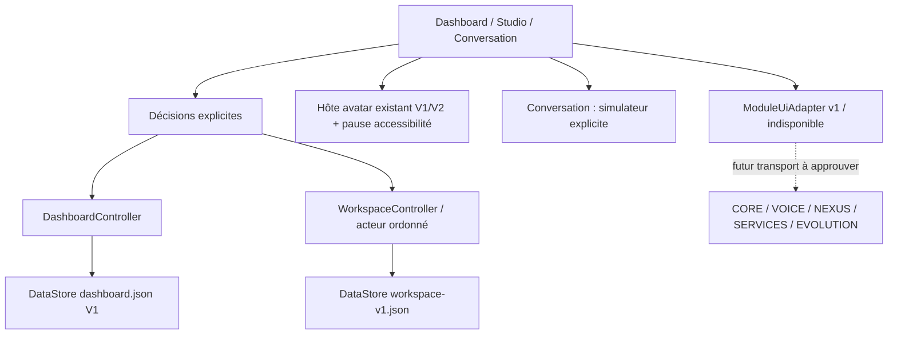

# INTERFACE-FINAL-01 — architecture locale

Branche `feat/interface-final-01`, base `0869b3959d3636deab3c938e6cb98b7e555f19af`.
La référence demandée AVA-03 `ab0a3f5a992a90ca53dc20c9c56d3bd8a0c2b3a0`
est vérifiée sur origin et ancêtre de cette base. UI-02, UI-03 et AVA-04 sont
conservées. Aucun autre dépôt ni branche par défaut modifié, aucune fusion.

## Responsabilités

- `domain/Dashboard.kt`, `HomeState.kt`, `storage/LayoutCodec.kt` et le dépôt
  DataStore existant : quatre panneaux, grille/collisions/verrouillages, deux profils.
  Ces fichiers restent identiques à la base, format dashboard.json V1 inchangé.
- `DashboardController` : ajout d'une commande ordonnée de restauration des deux
  profils ; validation puis écriture effective avant publication de la nouvelle géométrie.
- `DashboardGrid` : gestes conservés ; dialogue numérique X/Y/largeur/hauteur,
  masquage sans destruction et sélection automatique/forcée du profil. En mode étendu
  sur écran étroit, canvas horizontal ≥48dp/cellule ; aucune compression des cibles.
- `workspace/Workspace.kt` : préférences de présentation, personnalité locale,
  bibliothèque de dispositions, archivage consenti et configuration des modules.
  Catalogue stable d'extensions (conversation/services/connaissances/tâches/diagnostics).
  Ce catalogue ouvre des destinations ; il n'ajoute pas de nouveaux identifiants au
  format de grille V1. Les tâches/services/connaissances restent indisponibles sans
  adaptateur réel ; aucun nouveau widget externe n'est prétendu connecté.
- `WorkspaceCodec/WorkspaceStore` : sidecar DataStore indépendant, codec JSON strict,
  bornes, acteur ordonné Application. Pas d'écriture à chaque frame/événement de doigt.
  Les sliders envoient leur préférence à la fin de la manipulation. Les champs visuels
  modifiés sont fusionnés pour préserver les changements indépendants en attente.
- `WorkspaceScreen`, `LocalPersonaEditor` : navigation, décisions/confirmations,
  prévisualisations déterministes, SAF volontaire, état observable et erreurs explicites.
- `ChatController/ChatViewModel/ChatScreen` : démo inchangée, session ViewModel,
  sélection/copier/détails/sources/relance explicite en simulation et effacement RAM.
  Archive séparée dans le Studio, seulement sur opt-in et session inactive. La collecte ViewModel continue pendant Activity STOP ; l’acteur Application écrit hors du fil principal.
- `DocumentSource` : attribution textuelle bornée, sans résolution d'URI ni permission.
- `ModuleUiAdapter` v1 : interface interne sans codec wire. Défaut indisponible,
  simulateur explicitement non connecté ; aucune API externe inventée.
- `JarvisTheme/MainActivity` : trois palettes sombres, échelles cumulées avec Android,
  couleurs système lisibles et préférence d'accessibilité observable.
- `AvatarMotionPolicy` : politique de l'hôte qui utilise la pause de visibilité du
  contrôleur existant. Pas de duplication du contrôleur, ressource ou rig artistique.
  V1/V2 et fallback restent disponibles. Aucun asset Athéna privé ajouté à l'APK.

## Données, réversibilité et erreurs

`files/datastore/workspace-v1.json` possède `version:1`, `visual`, `persona`,
`layouts` (≤12 copies nommées des deux profils V1), `keepHistory`, `history`
(≤200 messages de ≤4000 caractères, sources ≤8) et `packages`.
Limite physique2MiB, JSON strict UTF-8, profondeur≤32, doublons refusés. Les plages,
identifiants, dimensions, collisions, noms, enums et permissions de conservation
sont contrôlés. Les extensions racine et visuelles/persona inconnues sont conservées.
Une limite dépassée refuse l'écriture et indique l'échec ; elle ne confirme pas une
sauvegarde partielle. Historique local non chiffré au niveau applicatif, dans l'espace
privé Android, exclu des backups par le manifeste existant ; ne pas y saisir des
secrets si le stockage du téléphone n'est pas suffisamment protégé.

Aucune migration des dispositions ou de l'identité CORE n'est nécessaire : sidecar
neuf, retrait de cette version laisse dashboard.json intact. Une rétrogradation à
l'APK précédent ignore le sidecar, sans le supprimer ; signature compatible requise.
Un fichier illisible ou de version future est conservé, le Studio désactive ses
écritures et l'application ouvre toujours le dashboard. Pas de remise à zéro silencieuse.
Pour une future V2 : conserver l'original, produire/valider une nouvelle copie,
écrire atomiquement, préserver extensions et anciennes données, proposer restauration
explicite ; ne jamais réinterpréter une version inconnue comme V1. Aucune migration
future non exécutée n'est présentée comme testée.

Le statut durable n'est donné qu'après `DataStore.updateData`. Échec : ancienne
préférence effective conservée, message non enregistré. Restauration d'une copie
écrit le fichier du dashboard avant sa publication. Les deux fichiers n'ont pas de
transaction commune : créer une copie n'active rien ; restaurer une copie ne modifie
ni la bibliothèque, ni le profil de personnalité, ni l'historique.

## Identité locale ≠ propriété CORE

Le profil local utilise les types UI existants (paramètres, contextes, goûts simulés,
règles lexicales bornées) et conserve les plafonds travail/urgence. Le détail est une
préférence de présentation locale, pas un champ ajouté au contrat CORE. Comparaison,
confirmation, annulation et préparation des défauts avant confirmation sont explicites.
Le profil est persistant seulement pour l'interface et ses gabarits ; aucune réponse
IA réelle, écriture de mémoire ou activation distante. L'ancien laboratoire UI-02
reste accessible et son comportement RAM n'est pas transformé en faux ACK CORE.

## Modules et sécurité

Le gestionnaire affiche les cinq modules, leur configuration et l'observation réelle
PackageManager demandée par l'utilisateur. Android11+ limite la visibilité :
`UNOBSERVABLE` signifie absent OU non visible. Pas de QUERY_ALL_PACKAGES.
Version installée ne signifie jamais CONNECTED : état INSTALLED_NOT_CONNECTED,
capacités non vérifiées. Réglages Android du paquet seulement après observation
positive et action explicite. Les erreurs observées restent RAM, une recréation
exige une nouvelle vérification. Les adaptateurs réels restent hors portée de cette
livraison : aucun Binder, réseau, signature supposée approuvée ou transfert sensible.

## Import/export

SAF système, aucun accès global aux fichiers et aucune permission INTERNET.
Export uniquement des deux profils actifs V1, jamais profil/historique/image.
Capture immuable au lancement, fichier cible nouveau et vide, écriture puis relecture
bornée ; annulation ou erreur ne produit pas de réussite. Import≤64KiB, validation
complète et aperçu des coordonnées/verrouillages des deux profils, puis confirmation.
Un import refusé ne modifie aucun fichier. L'application ne conserve pas les URI grants.

## Limites de qualification

« Final » désigne cette mission d'interface ; les modules non raccordés restent
indisponibles et les médias artistiques privés restent en revue séparée. Aucun
rendu artistique final ou lip-sync livré ici. Une expérience physique fluide sur
POCO X8 Pro / Redmi Pad SE doit être qualifiée sur ces appareils ; l'émulateur ne
remplace ni TalkBack réellement prononcé, ni mesures CPU/énergie/thermiques physiques.
