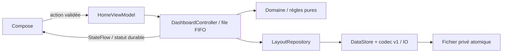

# Mission 005 — sauvegarde et restauration des dispositions

## Périmètre et branche

- Dépôt : `bubth720/JARVIS-INTERFACE` uniquement.
- Branche : `feature/interface-storage-005`.
- Base : `feature/interface-dashboard-004`, commit `d2a0ca05723c205e4351d03a3eeb5f2ce898f3a8`.
- Le commit contenant ce rapport porte la livraison ; son SHA est disponible dans
  l’historique de la branche et le workflow associé. Aucun merge, aucune modification
  de `main` ni des branches précédentes. `main` reste absente ; HEAD distant reste
  `development/mission-002`. L’organisation des branches attend la validation du propriétaire.

## Fonctionnement livré

Les quatre panneaux, profils compact/large, gestes, collisions, limites et minimums
3×3 sont conservés. Une action métier acceptée modifiant la géométrie ou un verrou
entraîne une écriture asynchrone. Le déplacement du doigt ne produit qu’un aperçu ;
seul le relâchement validé écrit. Refus, no-op, navigation et édition n’écrivent pas.

Le lancement attend le chargement/contrôle du fichier avant de rendre la grille.
Sans fichier, utiliser les valeurs initiales sans créer de fichier artificiellement.
Les profils sont enregistrés ensemble mais modifiables indépendamment ; changer
la taille de fenêtre ne réinitialise aucun profil. Les états temporaires restent
exclus du stockage et le nouveau processus ouvre l’accueil hors édition.

Les paramètres proposent « Restaurer la disposition par défaut », avec confirmation
et possibilité d’annuler. Les deux profils et les verrous sont réinitialisés puis
sauvegardés ; aucune autre donnée de l’application n’est effacée.

## Format et responsabilités

Jetpack **DataStore Core 1.1.7**, sérialiseur JSON **kotlinx.serialization 1.8.1** :
un fichier structuré léger, transactions atomiques, sans SQL, dépendance réseau ou
plugin de génération. Coroutines **1.10.2** pour les écritures et leurs tests.

```json
{
  "version": 1,
  "profiles": {
    "compact": [
      {"id":"avatar","x":0,"y":0,"width":3,"height":4,"locked":false}
    ],
    "wide": [
      {"id":"avatar","x":0,"y":0,"width":6,"height":3,"locked":false}
    ]
  }
}
```

Cet exemple abrégé montre un panneau par profil ; le fichier réel exige **les quatre
identifiants** `avatar`, `system`, `applications`, `commands` une seule fois par
profil. Coordonnées/dimensions en cellules logiques, pas en pixels. Les minimums
restent définis par le domaine. Chemin privé : `files/datastore/dashboard.json`.



Un singleton DataStore par fichier/processus appartient à `JarvisApplication`.
Le contrôleur vit pendant le processus, sans références d’Activity. Sa file FIFO
attend la fin de chaque écriture avant de traiter l’action suivante : pas de
concurrence, d’inversion des versions ni de coroutine de sauvegarde annulée par la
fermeture d’un écran. Les opérations disque sont sur Dispatchers.IO, pas le thread UI.

La nouvelle géométrie et son statut non durable sont publiés atomiquement. Seul le
retour réussi d’`updateData` produit **Disposition enregistrée**. Une erreur conserve
la géométrie visible, signale qu’elle n’est pas enregistrée et propose Réessayer ; une
modification valide suivante réécrit l’état complet. Une lecture impossible protège
le disque et peut être réessayée. Une réinitialisation échouée laisse l’état précédent.
Aucune promesse de sauvegarde n’est faite pour une écriture interrompue avant accusé.

## Intégrité et évolution

- UTF-8 strict, JSON objet, clés uniques même échappées, entiers/booléens stricts,
  taille maximale 65 536 octets et profondeur maximale 32 avant parsing.
- Deux profils complets, identifiants connus uniques, coordonnées/dimensions valides,
  minimums, limites et absence de collision contrôlés avant toute restauration.
- Corruption : valeurs initiales affichées, édition bloquée et fichier intact.
- Version inconnue, profil/panneau inconnu ou ensemble incomplet : même protection,
  sans suppression silencieuse. Le fichier n’est pas remplacé au lancement.
- Reset confirmé d’un fichier protégé : copie exacte vers
  `dashboard.recovery-<UUID>.json`, synchronisée avant remplacement ; échec d’archive
  = abandon du reset. Pas de récupération automatique destructive.
- Les champs supplémentaires de documents v1 supportés sont conservés à l’écriture,
  y compris lors du reset. Les formats futurs restent protégés jusqu’à une migration
  explicite testée. Ajouter un widget exige une migration versionnée validant les
  deux profils et conservant les anciennes configurations, sans collision.

## Fichiers créés et modifiés

Créés :

- `app/src/main/java/com/jarvis/interfaceapp/JarvisApplication.kt`
- `app/src/main/java/com/jarvis/interfaceapp/domain/LayoutRepository.kt`
- `app/src/main/java/com/jarvis/interfaceapp/storage/LayoutCodec.kt`
- `app/src/main/java/com/jarvis/interfaceapp/storage/DataStoreLayoutRepository.kt`
- `app/src/main/java/com/jarvis/interfaceapp/ui/DashboardController.kt`
- `app/src/test/java/com/jarvis/interfaceapp/storage/LayoutCodecTest.kt`
- `app/src/test/java/com/jarvis/interfaceapp/storage/DataStoreLayoutRepositoryTest.kt`
- `app/src/test/java/com/jarvis/interfaceapp/ui/DashboardControllerTest.kt`
- `app/src/androidTest/java/com/jarvis/interfaceapp/StorageInteractionTest.kt`
- `app/src/androidTest/java/com/jarvis/interfaceapp/StorageTestSupport.kt`
- `scripts/verify_storage_restart.py`, ce rapport et ses preuves de validation.

Modifiés : catalogue Gradle et `app/build.gradle.kts` (dépendances explicites),
manifest (classe Application uniquement), `MainActivity.kt` (injection),
`ui/HomeViewModel.kt` (délégation), `ui/JarvisApp.kt` (statut/reset/chargement),
`DashboardInteractionTest.kt` et `StandaloneStartupTest.kt` (fixtures indépendantes),
`README.md`, `docs/decisions.md`.

`Dashboard.kt`, `HomeState.kt`, `DashboardGrid.kt`, contrat avatar et workflow CI
ne changent pas. Aucun service ni permission ajouté ; minimum API 26 conservé.

## Validation

Commandes exécutées avec JDK 17, SDK 35 / Build Tools 35.0.0, Gradle 8.13 :

```sh
./scripts/check.sh --no-daemon
./gradlew connectedDebugAndroidTest --no-daemon
python3 scripts/verify_storage_restart.py --serial emulator-5554 --allow-layout-reset --reboot
```

Couverture des scénarios obligatoires :

| Scénario | Vérification |
| --- | --- |
| Première installation sans fichier | JVM dépôt/contrôleur + scénario ADB |
| Déplacement puis fermeture/réouverture | JVM nouveau DataStore + vrai arrêt ADB |
| Dimensions et verrous restaurés | JVM codec/dépôt + ADB avec contrôle de géométrie UI |
| Profils indépendants | JVM + changement de fenêtre compact/large ADB |
| Modifications rapides ordonnées | JVM contrôleur avec écriture suspendue |
| Placement refusé sans écriture | JVM + Android + comparaison des octets ADB |
| Corruption / version inconnue | JVM + ADB, original intact et archive vérifiée |
| Réinitialisation / annulation | JVM + Android + ADB après nouveau processus |
| Recréation d’activité | Instrumentation Android, distincte de la mort du processus |
| Arrêt réel puis nouveau démarrage | ADB force-stop, disparition du PID, PID différent |
| Redémarrage appareil | Redémarrage de l’émulateur, boot ID différent |

Résultats finaux et preuves : voir la section de clôture ci-dessous.

## Limites et risques de régression

- Aucun test physique POCO X8 Pro / Redmi Pad SE : suivre le README, notamment
  portrait/paysage, multifenêtre, TalkBack, arrêt forcé puis redémarrage hors ligne.
- CI standard : JVM/Lint/compilation des deux APK ; les tests instrumentés et arrêts
  réels sont exécutés séparément dans cet environnement sur émulateur API 26.
- Les changements en cours d’écriture peuvent être perdus si le processus est tué.
  Attendre l’accusé de sauvegarde. Pas de service permanent ni mécanisme de flush
  Android supposé garanti ; consommation événementielle, sans polling permanent.
- Le stockage privé et ses archives disparaissent à la désinstallation/effacement
  des données. Pas d’export, de backup distant ou de restauration inter-appareils.
- Les versions/widgets inconnus exigent une migration ou un reset explicite ; le
  blocage de l’édition protège les anciennes données mais peut nécessiter l’intervention
  de l’utilisateur. Les archives ne sont pas une interface d’import.
- Risques : I/O/disque plein, pression d’une file de commandes très rapide et
  changements de schéma futurs. Erreurs/retry, ordre des écritures, limites du fichier
  et protection de version sont testés. Aucun benchmark matériel ou coupure électrique
  n’est simulé ; un arrêt forcé n’équivaut pas à une coupure matérielle pendant fsync.

Prochaine action : validation utilisateur de la mission 005 et vérification physique
sur les deux appareils. Mission 006 recommandée : validation multiappareils et
durcissement de l’ergonomie/accessibilité, à définir après accord. Aucun connecteur ni
moteur d’avatar engagé, aucune fusion effectuée.

## Clôture de la validation locale

- Quatre tâches demandées : **réussies** (`BUILD SUCCESSFUL`, 32 s sur la dernière
  compilation locale, tâches incrémentales incluses).
- **59 tests JVM réussis, 0 échec, 0 erreur, 0 ignoré** : domaine existant 22,
  codec 16, DataStore réel 7, contrôleur 14. Les tests vérifient notamment qu’aucun
  observateur ne reçoit une nouvelle géométrie associée à un ancien accusé durable.
- Lint : **No issues found.** Les deux APK sont présents : application 9 867 894
  octets, tests 1 098 706 octets. Empreintes locales dans la preuve de compilation.
- **15 tests instrumentés réussis, 0 échec, 0 erreur, 0 ignoré**, sur le code final
  (`connectedDebugAndroidTest`, 2 min 18 s). Émulateur Android 8.0/API 26 x86_64,
  720×1280 / 320 dpi, mode avion, rendu logiciel sans KVM, sans CORE/VOICE/SERVICES.
  Les 10 tests précédents et 5 scénarios de stockage passent ; les tests de
  recréation ne sont pas présentés comme des tests de mort du processus.
- **11 scénarios ADB réussis**, dont déplacements/redimensionnements/verrous tactiles
  des deux profils, refus sans écriture, plusieurs vrais force-stop, reset durable,
  corruption/version inconnue protégées et archivées, autres données inchangées.
- Restauration personnalisée observée : compact Avatar `(0,1,3,3)`, verrouillé ;
  large Avatar `(0,1,5,3)`, libre. Les coordonnées, tailles et verrous du fichier
  sont contrôlés ainsi que la géométrie réellement affichée après relancement.
- Mort réelle : PID `3411` disparu, relancement PID `4053` ; depuis les paramètres,
  PID `4053` disparu, relancement PID `4425` sur l’accueil sans édition.
- Redémarrage complet : boot ID `68247543-e49d-4adc-95e7-43329860757d` remplacé par
  `9e261183-eea2-4e09-ba39-adc33167d389`, dispositions conservées. Le reset est
  également restauré après disparition du PID `2209`, nouveau PID `2803`.

Preuves conservées :

- [Compilation, suites JVM et empreintes APK](validation/mission-005-build.json)
- [Scénarios ADB, PID et boot ID](validation/mission-005-restart.json)
- [Rapport JUnit des 15 tests Android](validation/mission-005-instrumented.xml)
- [Fichier final après réinitialisation](validation/mission-005-default-layout.json)

Les rapports complets locaux sont dans `app/build/test-results/testDebugUnitTest/`,
`app/build/reports/lint-results-debug.*`, `app/build/outputs/androidTest-results/connected/debug/`,
`app/build/reports/androidTests/connected/debug/` et `app/build/reports/storage-restart/`.

## Validation distante et artefacts

Le [workflow Android de cette branche](https://github.com/bubth720/JARVIS-INTERFACE/actions?query=branch%3Afeature%2Finterface-storage-005)
compile et contrôle le commit poussé. Le lien du run et son SHA exact figurent dans
le bilan final de livraison ; vérifier le run correspondant au commit consulté.
Les étapes Gradle, contrôle des APK/tests réellement exécutés et uploads doivent
être réussies avant acceptation. Aucun test instrumenté distant n’est revendiqué.

Artefacts existants préservés : **jarvis-interface-apks** (les deux APK) et
**android-validation-reports** (JUnit XML/HTML et Lint), selon la rétention GitHub
configurée. Les journaux bruts nécessitant l’authentification GitHub ne sont pas
présentés comme lus ; le statut public des runs et de leurs étapes est vérifiable.
